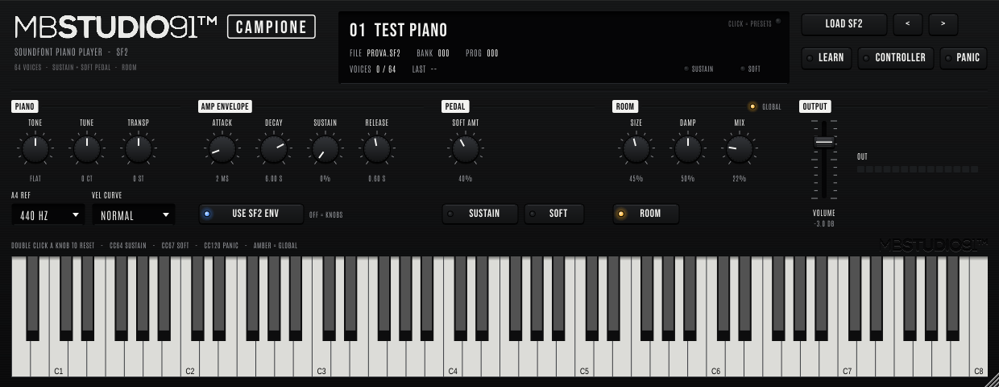

# MBStudio91 Campione

Campione è un player SoundFont 2 pensato per il pianoforte, in formato VST3, AU (Mac) e applicazione autonoma. L'interfaccia segue lo stile hardware dei plugin MBStudio91 (MuMU, LA-91, ICX7): telaio nero, scritte bianche, colore solo nei LED.



## Scaricare

Ogni aggiornamento del ramo `main` viene compilato da GitHub Actions. I file pronti sono nella pagina **Releases**:

- `Campione-VST3-mac.zip`, `Campione-AU-mac.zip`, `Campione-App-mac.zip` per Mac (Apple Silicon e Intel, macOS 11 o successivo)
- `Campione-VST3-win.zip`, `Campione-App-win.zip` per Windows a 64 bit

Il plugin per Mac non è firmato da Apple. Dopo averlo copiato serve questo comando nel Terminale:

```
xattr -dr com.apple.quarantine ~/Library/Audio/Plug-Ins/VST3/"MBStudio91 Campione.vst3" ~/Library/Audio/Plug-Ins/Components/"MBStudio91 Campione.component" /Applications/"MBStudio91 Campione.app"
```

## Come si usa

Campione non contiene suoni: si carica un proprio file `.sf2` con **LOAD SF2** oppure trascinandolo sul pannello. Parte il preset banco 0 programma 0 (il pianoforte acustico nei SoundFont General MIDI), altrimenti il primo dell'elenco. Un clic sul display apre l'elenco dei preset, diviso per banco; `<` e `>` passano al precedente e al successivo. Il percorso del file e il preset vengono salvati nel progetto.

| Sezione | Controlli |
|---|---|
| PIANO | TONE (inclinazione ±9 dB, 250 Hz e 2,5 kHz), TUNE (±50 centesimi), TRANSP (±12 semitoni), A4 REF (440 o 432 Hz), VEL CURVE (NORMAL, SOFT, HARD, FIXED) |
| AMP ENVELOPE | Con USE SF2 ENV acceso vale l'inviluppo del SoundFont. Spento, ATTACK, DECAY, SUSTAIN e RELEASE lo sostituiscono per le note nuove |
| PEDAL | SUSTAIN (anche CC 64), SOFT una corda (anche CC 67), SOFT AMT quanto abbassa la dinamica |
| ROOM | Riverbero: SIZE, DAMP, MIX, acceso o spento |
| OUTPUT | VOLUME e LED meter |

Altro dal MIDI: Program Change con banco da CC 0 e CC 32, pitch bend (±2 semitoni), CC 7, 10, 11, CC 120 e 123. Il tasto PANIC spegne tutte le voci in pochi millisecondi e azzera pedali e pitch bend. LEARN e CONTROLLER fanno il MIDI Learn su qualsiasi controllo e caricano i profili dei controller, come negli altri plugin MBStudio91.

## Limiti attuali

- Legge solo SoundFont 2 (`.sf2`). SFZ e SF3 non sono ancora supportati.
- Il motore è TinySoundFont, che non applica i modulatori del SoundFont e ignora le mandate di chorus e riverbero scritte nel file. Il riverbero di Campione è la sezione ROOM.
- Il mezzo pedale non è gestito: il sustain è acceso o spento.
- 64 voci al massimo. Quando sono tutte occupate si libera la voce più avanti nel rilascio; se tutte le note sono ancora tenute, la nota nuova non suona.

## Compilare in proprio

```
cmake -S . -B build -DCMAKE_BUILD_TYPE=Release
cmake --build build --config Release
```

JUCE 9.0.5 viene scaricato da CMake. Per la prova del motore senza interfaccia:

```
cmake -S . -B build -DCAMPIONE_BUILD_TOOLS=ON
cmake --build build --target campione_render
python3 tools/make_test_sf2.py prova.sf2
./build/campione_render_artefacts/Release/campione_render prova.sf2 accordo.wav
```

`make_test_sf2.py` crea un SoundFont con suoni sintetici; la prova controlla intonazione, trasposizione, 432 Hz, sustain da pannello e da CC 64, inviluppo sostituito e ripristinato, curva di velocity, pedale una corda, Program Change e PANIC. Gira anche su GitHub a ogni commit.

## Licenze

- Codice di Campione: GNU AGPL v3 (`LICENSE.md`), come gli altri plugin MBStudio91 basati su JUCE.
- TinySoundFont di Bernhard Schelling, licenza MIT (`third_party/TinySoundFont/LICENSE`), file `tsf.h` dal commit 790a219.
- Font Bebas Neue e Antonio: SIL Open Font License 1.1 (`MBStudioUI/fonts`).
- VST è un marchio registrato di Steinberg Media Technologies GmbH.
